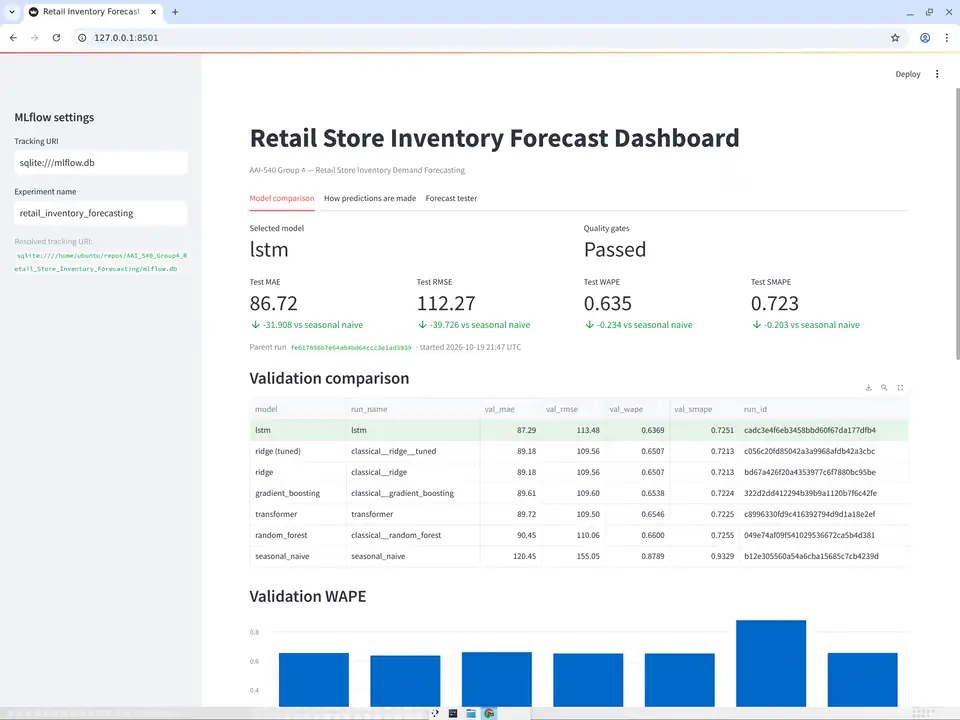

# Retail Store Inventory Demand Forecasting

**Group 4 — AAI-540 Final Project**

**Business scenario:** Retail Store Inventory Forecasting (academic project)
**Date:** October 2026

---

## Table of Contents

1. [Project Overview](#project-overview)
2. [Project Background](#project-background)
3. [Technical Architecture](#technical-architecture)
4. [Dataset Information](#dataset-information)
5. [Project Structure](#project-structure)
6. [Setup Instructions](#setup-instructions)
7. [Pipeline Workflow](#pipeline-workflow)
8. [Model Training](#model-training)
9. [Model Evaluation](#model-evaluation)
10. [MLOps with MLflow](#mlops-with-mlflow)
11. [AWS SageMaker Deployment](#aws-sagemaker-deployment)
12. [Usage Examples](#usage-examples)
13. [Configuration](#configuration)
14. [Troubleshooting](#troubleshooting)
15. [Future Improvements](#future-improvements)
16. [Contributors](#contributors)
17. [Contact](#contact)

---

## Project Overview

This project implements a production-oriented machine learning system that forecasts daily retail demand (`Units Sold`) per store/product, following the AAI-540 MLOps lifecycle: data ingestion, feature engineering, model training/comparison, evaluation, experiment tracking, and AWS SageMaker deployment.

### Key Features

- **Modular architecture**: separated components for data ingestion, preprocessing, feature engineering and modeling, mirroring a standard MLOps project layout
- **Model comparison across three families**: a seasonal-naive baseline, classical ML (Ridge / Random Forest / Gradient Boosting) on engineered tabular features, and deep learning sequence models (LSTM and a Transformer encoder) — as called for in the design document's comparison of LSTM vs. Transformer architectures
- **Leakage-safe, chronological evaluation**: time-based 70/15/15 split, lag/rolling features that only look backward, decision thresholds and hyperparameters tuned without ever touching the test split
- **MLOps integration**: MLflow experiment tracking, model registry pattern, SageMaker Feature Store / Model Registry / batch inference / monitoring
- **Quality gates**: the pipeline fails loudly if the selected model does not clear a minimum WAPE and a minimum improvement over the naive baseline

---

## Project Background

### Business Problem

Retail organizations must balance product availability against the cost of carrying excess inventory. Underestimating demand causes stockouts and lost sales; overestimating it causes markdowns and holding costs. This project builds a repeatable workflow that predicts near-term demand per (store, product, day) from historical sales, calendar effects, and pricing/promotion signals, so that the output can feed downstream inventory-planning decisions.

### Dataset

The project uses the **Kaggle "Retail Store Inventory Forecasting" dataset**, a synthetic dataset of daily store/product-level sales.

**Dataset Source:** [Kaggle](https://www.kaggle.com/datasets/anirudhchauhan/retail-store-inventory-forecasting-dataset)

**Dataset Size:** 73,100 daily records (5 stores × 20 products × 731 days, 2022-01-01 to 2024-01-01)

---

## Technical Architecture

### Technology Stack

- **Language:** Python 3.10+
- **Data Processing:** pandas, numpy
- **Machine Learning:** scikit-learn
- **Deep Learning:** TensorFlow / Keras (LSTM, Transformer encoder)
- **MLOps:** MLflow
- **Visualization:** matplotlib, seaborn
- **Configuration:** PyYAML
- **Containerization:** Docker
- **Testing:** pytest
- **Cloud:** AWS SageMaker (SDK v2), S3, CloudWatch

### Architecture Components

```
┌─────────────────────────────────────────────────────────────┐
│                     Data Ingestion Layer                      │
│  - Load the Kaggle CSV (Date, Store ID, Product ID, ...)      │
│  - Schema & data-quality validation (types, nulls, negative   │
│    targets, duplicate (date, store, product) keys)            │
│  - Chronological (non-shuffled) 70 / 15 / 15 split            │
└─────────────────────────────────────────────────────────────┘
                              ↓
┌─────────────────────────────────────────────────────────────┐
│      Feature Engineering (per store/product series)           │
│  - Drop 'Demand Forecast', 'Inventory Level', 'Units Ordered' │
│    (target leakage / downstream operational outcomes)         │
│  - Calendar features: day-of-week, month, quarter, year,      │
│    week-of-year, is_weekend                                   │
│  - Lag features (1/7/14/30 days) and rolling mean/std          │
│    (7/14/30 days), shifted so no row sees its own target      │
│  - Sliding-window sequences (length 30) for the DL models      │
└─────────────────────────────────────────────────────────────┘
                              ↓
┌─────────────────────────────────────────────────────────────┐
│                    Model Training Layer                       │
│  - Seasonal-naive baseline (value 7 days ago)                 │
│  - Classical ML: Ridge, Random Forest, Gradient Boosting on    │
│    one-hot + scaled tabular features, tuned with a             │
│    TimeSeriesSplit-based RandomizedSearchCV                   │
│  - Deep learning: stacked LSTM and a small Transformer         │
│    encoder, trained globally across every store/product        │
│    series, with early stopping on validation loss             │
└─────────────────────────────────────────────────────────────┘
                              ↓
┌─────────────────────────────────────────────────────────────┐
│                  Model Evaluation Layer                       │
│  - MAE, RMSE, WAPE, sMAPE on validation, once on test          │
│  - Segment breakdown by store / category                      │
│  - Quality gates (WAPE ceiling, MAE improvement over naive)    │
│    fail the pipeline if not met                                │
└─────────────────────────────────────────────────────────────┘
                              ↓
┌─────────────────────────────────────────────────────────────┐
│                MLOps Layer (MLflow, SQLite backend)           │
│  - Nested run per model/strategy, comparison table             │
│  - models/model.joblib or model.keras + model_metadata.json   │
└─────────────────────────────────────────────────────────────┘
                              ↓
┌─────────────────────────────────────────────────────────────┐
│            AWS SageMaker Layer (src/aws/sagemaker)             │
│  - S3 raw/processed data, SageMaker Feature Store              │
│  - Managed training job (TensorFlow estimator)                 │
│  - Model Registry, batch transform (primary inference          │
│    pattern), optional real-time endpoint                       │
│  - Model/data/infrastructure CloudWatch dashboards              │
└─────────────────────────────────────────────────────────────┘
```

---

## Dataset Information

### Data Source

**File:** `data/raw/retail_store_inventory.csv`
**Format:** Comma-separated CSV
**Records:** 73,100 (5 stores × 20 products × 731 days)

### Features

| Feature | Type | Description |
|---|---|---|
| Date | date | Calendar day (2022-01-01 to 2024-01-01) |
| Store ID | categorical | One of 5 stores (S001–S005) |
| Product ID | categorical | One of 20 products (P0001–P0020) |
| Category | categorical | Electronics, Clothing, Groceries, Toys, Furniture |
| Region | categorical | North / South / East / West |
| Inventory Level | numeric | Stock at the start of the day *(excluded — downstream of sales)* |
| Units Sold | numeric | **Target** |
| Units Ordered | numeric | Replenishment quantity *(excluded — downstream of sales)* |
| Demand Forecast | numeric | The dataset's own pre-computed forecast *(excluded — leaks the target)* |
| Price | numeric | Unit price |
| Discount | numeric | Discount percentage |
| Weather Condition | categorical | Sunny / Rainy / Snowy / Cloudy |
| Holiday/Promotion | binary | Holiday or promotion indicator |
| Competitor Pricing | numeric | Competitor's price for the same product |
| Seasonality | categorical | Spring / Summer / Autumn / Winter |

### Data Characteristics

- **No missing values, no duplicate (Date, Store ID, Product ID) keys.**
- **Synthetic data:** stores/products/categories/regions are near-perfectly balanced, and — confirmed in `notebooks/exploratory_data_analysis.ipynb` — there is essentially **no real weekly seasonality** (daily totals vary by day-of-week within noise) and **no measurable promotion effect** (mean `Units Sold` with vs. without `Holiday/Promotion` differs by <0.1%). This caps how much any model, including the LSTM/Transformer, can improve over a naive baseline.
- **Leakage:** `Demand Forecast` correlates 0.997 with `Units Sold` by construction and is excluded. `Inventory Level` and `Units Ordered` are partly determined by `Units Sold` after the fact and are also excluded.

---

## Project Structure

```
AAI_540_Group4_Retail_Store_Inventory_Forecasting/
├── data/
│   ├── raw/                     # retail_store_inventory.csv (committed; ~6 MB, synthetic)
│   ├── processed/                # train/val/test Parquet splits (generated)
│   └── external/
├── notebooks/
│   ├── exploratory_data_analysis.ipynb
│   ├── model_development.ipynb
│   └── model_evaluation.ipynb
├── src/
│   ├── data_ingestion/
│   │   └── data_ingestion.py          # load, schema/quality validation, chronological split
│   ├── data_preprocessing/
│   │   └── data_preprocessing.py      # cleaning, ColumnTransformer, prediction clipping
│   ├── feature_engineering/
│   │   └── feature_engineering.py     # calendar/lag/rolling features, sequence builder
│   ├── models/
│   │   ├── baseline.py                # seasonal-naive model
│   │   ├── train_model.py             # classical ML (Ridge/RF/GB) + tuning
│   │   ├── sequence_models.py         # LSTM + Transformer (Keras)
│   │   └── predict_model.py           # MAE/RMSE/WAPE/sMAPE, segment breakdown
│   ├── pipelines/
│   │   └── training_pipeline.py       # end-to-end orchestration + MLflow + quality gates
│   ├── utils/
│   │   └── helpers.py
│   └── aws/
│       └── sagemaker/
│           ├── data_upload.py          # S3 data upload
│           ├── feature_store.py        # SageMaker Feature Store
│           ├── training.py             # SageMaker managed training (TensorFlow estimator)
│           ├── deployment.py           # optional real-time endpoint
│           ├── batch_inference.py      # batch transform (primary inference pattern)
│           ├── model_registry.py       # Model Registry
│           ├── pipeline.py             # SageMaker Pipeline (CI/CD DAG): preprocess/train/evaluate/quality-gate/register
│           ├── monitoring.py           # Model Monitor + forecast-accuracy CloudWatch metrics
│           ├── monitoring_reports.py   # model-quality + data-quality reports (reports/monitoring/)
│           ├── infrastructure_monitoring.py  # CloudWatch dashboards
│           ├── rollback.py             # rollback utilities
│           ├── pipeline_scripts/
│           │   ├── preprocess.py       # Pipeline's Processing step entry point
│           │   ├── evaluate.py         # Pipeline's EvaluateModel step entry point
│           │   └── requirements.txt
│           └── scripts/
│               ├── train.py            # SageMaker training entry point
│               ├── inference.py        # real-time endpoint entry point
│               ├── batch_transform.py  # batch transform entry point
│               └── requirements.txt
├── models/                        # model.joblib or model.keras + model_metadata.json (generated)
├── mlflow.db                       # MLflow tracking store (generated)
├── docs/
│   ├── OPERATIONS_RUNBOOK.md       # step-by-step: pipeline, registry, monitoring, dashboard
│   ├── architecture_diagram.png
│   ├── DESIGN_DOCUMENT.md          # as-built ML Design Document (+ DESIGN_DOCUMENT.docx)
│   └── VIDEO_SCRIPT.md             # demo video script with exact AWS console click paths
├── tests/
│   ├── test_data_preprocessing.py
│   ├── test_model_training.py
│   └── aws/
│       ├── test_pipeline.py
│       └── test_monitoring.py
├── .github/workflows/ci-cd.yml
├── requirements.txt
├── Dockerfile
├── config.yaml
├── validate_aws_setup.py
├── deploy_sagemaker_lab.py
└── README.md
```

---

## Setup Instructions

### Prerequisites

- Python 3.10 or higher
- pip
- Git

### Installation Steps

1. **Clone the repository and switch to this branch**
   ```bash
   git clone https://github.com/vedpd/AAI_540_Group4_Retail_Store_Inventory_Forecasting.git
   cd AAI_540_Group4_Retail_Store_Inventory_Forecasting
   git checkout ved-development
   ```

2. **Create a virtual environment**
   ```bash
   python -m venv venv
   source venv/bin/activate  # On Windows: venv\Scripts\activate
   ```

3. **Install dependencies**
   ```bash
   pip install -r requirements.txt
   ```

4. **Verify installation**
   ```bash
   python -c "import pandas, sklearn, tensorflow, mlflow; print('Dependencies installed successfully')"
   ```

5. **Dataset**: `data/raw/retail_store_inventory.csv` is already committed (synthetic, ~6 MB). If it's missing, download it from [Kaggle](https://www.kaggle.com/datasets/anirudhchauhan/retail-store-inventory-forecasting-dataset) and place it at that path.

### Project documentation

- [docs/OPERATIONS_RUNBOOK.md](docs/OPERATIONS_RUNBOOK.md) — step-by-step for the SageMaker Pipeline CI/CD DAG
  (`python -m src.aws.sagemaker.pipeline`), the model- and data-quality monitoring reports
  (`python -m src.aws.sagemaker.monitoring_reports`), and the CloudWatch infrastructure dashboard, with where to
  inspect each result in Studio/the console.
- [docs/DESIGN_DOCUMENT.md](docs/DESIGN_DOCUMENT.md) (also provided as `DESIGN_DOCUMENT.docx`) — the full
  as-built ML System Design Document: business problem, data/EDA findings, model comparison and test metrics,
  MLOps/CI-CD architecture, monitoring, security checklist, and an Engineering Challenges & Lessons Learned
  section documenting the real bugs hit and fixed during development.
- [docs/VIDEO_SCRIPT.md](docs/VIDEO_SCRIPT.md) — demo video script with timed segments and exact AWS console
  click paths for a walkthrough recording.

### Running on AWS SageMaker AI

This project targets **SageMaker Python SDK v2** (pinned in `requirements.txt` as `sagemaker>=2.190.0,<3.0.0`), since the SDK v3 made breaking API changes to `FeatureGroup`, estimators and models that this project's `src/aws/sagemaker/` modules rely on. If you're working in SageMaker Studio / Studio Lab:

```bash
pip install -r requirements.txt
python validate_aws_setup.py          # checks credentials, role, S3, CloudWatch, data file
python deploy_sagemaker_lab.py        # sanity-checks AWS clients, prints next steps
```

---

## Dashboard

From the repository root, install Streamlit and MLflow if needed, then run:

```bash
pip install streamlit mlflow
streamlit run src/ui/app.py --server.headless true --server.enableCORS false --server.enableXsrfProtection false
```

In SageMaker Studio JupyterLab, open `https://<space-id>.studio.<region>.sagemaker.aws/jupyterlab/default/proxy/8501/`.
Get this URL from the JupyterLab address by replacing everything after `/jupyterlab/default/` with `proxy/8501/`.
Streamlit's Network and External URLs are not reachable from outside the Studio container. Classic Studio uses
`/jupyter/default/proxy/8501/`.

Model comparison reads `mlflow.db` in the repository root (`mlflow.tracking_uri` in `config.yaml`); run
`python -m src.pipelines.training_pipeline` from the repository root first.

### Walkthrough



---

## Pipeline Workflow

### Step 1: Data Ingestion

**Location:** `src/data_ingestion/data_ingestion.py`

- `load_data(file_path)`: loads the CSV, parses `Date`
- `validate_schema(df)`: checks column presence, numeric types, nulls, negative targets, duplicate keys; returns a data-quality report
- `chronological_cutoffs(dates, val_size, test_size)` / `split_data(df, val_size, test_size)`: a single global date cutoff separates train/val/test — **no shuffling**, since every store/product shares the same calendar and shuffling would leak future rows into training

### Step 2: Feature Engineering

**Location:** `src/feature_engineering/feature_engineering.py`

- `add_calendar_features(df)`: day-of-week, month, quarter, year, week-of-year, is_weekend
- `add_lag_rolling_features(df, group_cols, target_col, lag_days, rolling_windows)`: per-(store, product) lag and rolling mean/std of `Units Sold`, computed on the **full chronologically sorted dataset before splitting** — this is not leakage, since every lag/rolling value only looks at strictly earlier dates of the same series (exactly what would be available in production)
- `build_sequences(...)`: sliding (sequence_length, n_features) windows per series for the LSTM/Transformer models

### Step 3: Model Training

**Location:** `src/models/`

| Model family | File | Notes |
|---|---|---|
| Seasonal-naive | `baseline.py` | Predicts `Units Sold` from 7 days ago; no training |
| Ridge / Random Forest / Gradient Boosting | `train_model.py` | One-hot + scaled tabular features; `TimeSeriesSplit`-based `RandomizedSearchCV` for tuning (never a shuffled K-fold) |
| LSTM / Transformer | `sequence_models.py` | Trained as "global" models across every store/product series; early stopping on validation loss |

### Step 4: Model Evaluation

**Location:** `src/models/predict_model.py`

- `evaluate_forecast(y_true, y_pred)`: MAE, RMSE, WAPE, sMAPE
- `evaluate_by_segment(y_true, y_pred, segment)`: breakdown by store/category, since aggregate metrics can mask poor performance on smaller segments
- Predictions are clipped to zero (`clip_non_negative`) since units sold cannot be negative

---

## Model Training

### Running the Training Pipeline

```bash
python -m src.pipelines.training_pipeline
```

**Pipeline Steps:**
1. Load `config.yaml`, load and validate the raw data, log the data-quality report
2. Drop leaky/downstream features, add calendar + lag/rolling features
3. Chronological 70/15/15 split; save Parquet splits to `data/processed/`
4. Score the seasonal-naive baseline on validation
5. Fit and score Ridge / Random Forest / Gradient Boosting on validation; tune the best one with `TimeSeriesSplit`
6. Train LSTM and Transformer sequence models on validation
7. Pick the overall best candidate by validation WAPE
8. Evaluate once on the untouched test split (technical metrics + comparison to the naive baseline)
9. Check quality gates; fail the run if they are not met
10. Log everything to MLflow and save `models/model.joblib` (classical) or `models/model.keras` + `models/sequence_scaler.joblib` (LSTM/Transformer), plus `models/model_metadata.json`

### Results (test split, 10,500 rows, cutoffs 2023-06-05 / 2023-09-18)

Validation comparison (best candidate per family):

| Model | Val WAPE | Val MAE |
|---|---|---|
| **LSTM (selected)** | 0.647 | 88.7 |
| Classical (tuned Ridge) | 0.651 | 89.2 |
| Transformer | 0.654 | 89.7 |
| Seasonal-naive | 0.879 | 120.5 |

Test set:

| Metric | Selected model (LSTM) | Seasonal-naive |
|---|---|---|
| MAE | 87.93 | 118.62 |
| RMSE | 108.33 | — |
| WAPE | 0.644 | 0.868 |
| sMAPE | 0.716 | — |

**MAE improvement over the naive baseline: 25.9%**

**Findings on model comparison:** all four real models (Ridge, Random Forest, Gradient Boosting, LSTM, Transformer) land within about 1% WAPE of each other, well ahead of the seasonal-naive baseline but far from a low-error forecast. As confirmed in the EDA notebook, this is expected: the Kaggle dataset is synthetic with essentially no weekly seasonality or promotion effect, so there is little additional structure for a more expressive model (LSTM/Transformer) to exploit beyond what lag/rolling features already give the classical models. The meaningful, checkable result here is the **~26% MAE improvement over a trivial baseline**, not the small gap between model families.

---

## Model Evaluation

### Evaluation Metrics

- **MAE / RMSE:** absolute error scale
- **WAPE:** primary selection metric — scale-independent and well-defined even for the many low-volume store/product/day rows (unlike MAPE, which blows up near zero actuals)
- **sMAPE:** reported as a supplementary metric
- Segment breakdowns by store and category (`evaluate_by_segment`) catch cases where aggregate metrics mask poor performance on a subset

### Quality Gates

Configured in `config.yaml` under `training.quality_gates` (WAPE ≤ 0.70, MAE improvement over naive ≥ 10%). The pipeline raises an error and tags the MLflow run `quality_gates_passed=False` if the test metrics fall short.

---

## MLOps with MLflow

### MLflow Tracking

```bash
mlflow ui --backend-store-uri sqlite:///mlflow.db
```

**Access:** http://localhost:5000

### Experiment Tracking

Each pipeline run creates a parent run `training_pipeline` with:
- Nested runs per candidate (seasonal-naive, each classical model + its tuned version, LSTM, Transformer)
- `model_comparison.json` and `data_quality_report.json`
- Selected model type, hyperparameters, validation and test metrics
- For LSTM/Transformer, per-epoch train/val loss curves

### Loading a Trained Model

```python
import json, joblib

metadata = json.load(open('models/model_metadata.json'))

if metadata['model_type'] in ('lstm', 'transformer'):
    import tensorflow as tf
    model = tf.keras.models.load_model('models/model.keras')
    scaler = joblib.load('models/sequence_scaler.joblib')
    # build (sequence_length, n_features) windows with src.feature_engineering.build_sequences,
    # then scale with src.models.sequence_models.apply_sequence_scaler before predicting
else:
    model = joblib.load('models/model.joblib')
    predictions = model.predict(raw_feature_dataframe)  # raw columns, pipeline handles preprocessing
```

---

## AWS SageMaker Deployment

This project includes AWS SageMaker integration per the ML System Design Document, built around **batch inference as the primary deployment pattern** (retail demand forecasts are generated on a schedule, not per individual request), with a real-time endpoint kept as an optional extension.

### SageMaker Components

1. **Data Upload to S3** — raw dataset and processed train/val/test splits
2. **Feature Store** — a Feature Group keyed on a composite `record_id` (Date # Store ID # Product ID), since the dataset's natural key isn't a single column
3. **Training Jobs** — managed `TensorFlow` estimator training job (LSTM by default; `--model_type ridge` trains the classical baseline with the same entry point)
4. **SageMaker Pipeline (CI/CD DAG)** — `retail-forecasting-pipeline`: `Preprocess → TrainModel → EvaluateModel → CheckQualityGate → RegisterModel | QualityGateFailed`. The quality gate requires test WAPE at or below a configurable threshold (default 0.70) *and* a minimum relative improvement over a seasonal-naive baseline (default 10%) before a model package is ever registered; a failing run stops at `QualityGateFailed` instead of silently registering. See [docs/OPERATIONS_RUNBOOK.md](docs/OPERATIONS_RUNBOOK.md) for a passing-vs-failing demonstration.
5. **Model Registry** — model package group `retail-inventory-forecasting-models`; pipeline-registered packages carry `evaluation.json` as model metrics and start `PendingManualApproval`
6. **Batch Inference** — the primary inference pattern; batch transform job over a prepared feature file
7. **Model Deployment** — optional real-time endpoint for ad hoc scoring
8. **Model Monitoring** — SageMaker Model Monitor data-quality baseline/drift analysis with a PSI drift table, and a model-quality report joining batch predictions against actuals (MAE/RMSE/WAPE overall and per store/category/region), both via `monitoring_reports.py`; custom CloudWatch metrics published to `RetailForecasting/ModelQuality`
9. **Infrastructure Monitoring** — a CloudWatch dashboard (`ml-system-monitoring`) built from `SEARCH()` metric-math expressions tracking pipeline executions, per-job CPU/memory, Feature Store calls, S3 size, forecast accuracy, and the optional endpoint — new jobs appear automatically without editing the dashboard
10. **Rollback** — revert an endpoint to a previous approved model package

### Prerequisites

- AWS account/lab with SageMaker, S3 and CloudWatch access
- AWS credentials configured in a `.env` file:
  ```bash
  AWS_ACCOUNT_ID=your_account_id
  AWS_REGION=us-east-1
  AWS_ROLE_ARN=arn:aws:iam::your_account_id:role/your_role
  ```

### AWS SageMaker Workflow

**Imperative path** (run each AWS component as a standalone script/job — useful for development and debugging one step at a time):

```bash
python validate_aws_setup.py
python -m src.aws.sagemaker.data_upload
python -m src.aws.sagemaker.feature_store
python -m src.aws.sagemaker.training
TRAINING_JOB_NAME=<job-name> python -m src.aws.sagemaker.model_registry
python -m src.aws.sagemaker.batch_inference
python -m src.aws.sagemaker.monitoring
python -m src.aws.sagemaker.infrastructure_monitoring
python -m src.aws.sagemaker.monitoring_reports all
```

**Managed Pipeline path** (the actual CI/CD DAG — this is what populates the **Pipelines** tab in
SageMaker Studio; the imperative commands above create raw Training/Transform/Processing jobs
instead, which show up under their own respective tabs, *not* under Pipelines):

```bash
python -m src.aws.sagemaker.pipeline upsert                                    # registers the pipeline definition
python -m src.aws.sagemaker.pipeline run --display-name gate-pass --wait       # passes the quality gate, registers a model
python -m src.aws.sagemaker.pipeline run --display-name gate-fail --max-wape 0.50 --wait  # intentionally fails the gate
python -m src.aws.sagemaker.pipeline status
```

See [docs/OPERATIONS_RUNBOOK.md](docs/OPERATIONS_RUNBOOK.md) for the full step-by-step (including
where to inspect each result in Studio/the console) and [docs/VIDEO_SCRIPT.md](docs/VIDEO_SCRIPT.md)
for exact click paths through the AWS console for a demo recording.

**Note:** this project pins `sagemaker>=2.190.0,<3.0.0` because the SageMaker AI lab environment this was developed against does not support the breaking changes introduced in SageMaker Python SDK v3. In practice, an AWS Academy Learner Lab session restart can still surface a fresh Studio kernel whose base environment provides SageMaker functionality via AWS's newer modularized SDK components rather than this pinned package — if you hit `ModuleNotFoundError`/`AttributeError`s referencing `sagemaker.model_monitor` or `sagemaker.Session` that weren't there before, run `pip install "sagemaker>=2.190.0,<3.0.0"` again in that kernel.

---

## Testing the Model / Endpoint

`src/ui/app.py` is a small Streamlit app for interactively testing a forecast without writing code — useful for sanity-checking a trained model and for demonstrating endpoint invocation.

```bash
streamlit run src/ui/app.py
```

It supports two modes, selectable in the sidebar:
- **Local model**: loads `models/model.keras` + `models/sequence_scaler.joblib` directly and predicts in-process (no AWS needed).
- **SageMaker endpoint**: sends the same feature window as a JSON payload to a deployed real-time endpoint (`python -m src.aws.sagemaker.deployment` must have been run first) and shows the raw request/response.

Pick a Store ID / Product ID / as-of date, optionally override Price/Discount/Holiday-Promotion for a what-if scenario, and click "Generate forecast". The app also plots recent actual demand for context.

---

## Usage Examples

```python
from src.pipelines.training_pipeline import TrainingPipeline

pipeline = TrainingPipeline('config.yaml')
result = pipeline.run(data_path='data/raw/retail_store_inventory.csv')

print(result['best_model'], result['test_metrics'])
```

---

## Configuration

All pipeline behavior is controlled by `config.yaml`:

- `data`: raw/processed paths, chronological split sizes, leaky features to exclude
- `feature_engineering`: lag days, rolling windows, sequence length for the DL models
- `training`: candidate models, selection metric (WAPE), deep-learning hyperparameters, quality gates
- `evaluation`: metrics to compute
- `mlflow` / `aws`: tracking URI, experiment name, S3 prefix, Feature Store / Model Registry names

---

## Troubleshooting

- **`ModuleNotFoundError: No module named 'tensorflow'`** — install the full `requirements.txt`; TensorFlow is required for the LSTM/Transformer candidates.
- **SageMaker SDK errors mentioning `FeatureGroup` or estimator signatures** — confirm `pip show sagemaker` reports a `2.x` version; this project is not compatible with SageMaker SDK v3.
- **Training pipeline fails quality gates** — this is intentional if the selected model doesn't clear the configured WAPE/MAE-improvement thresholds in `config.yaml: training.quality_gates`; it is not a crash.
- **Corporate network / self-signed certificate errors during `pip install`** — if your environment intercepts TLS, you may need `pip install --trusted-host pypi.org --trusted-host files.pythonhosted.org ...`.

---

## Future Improvements

- Store/product embeddings instead of one-hot encoding for the DL models (noted in the design document as a possible extension)
- Prediction intervals / quantile forecasts to support safety-stock policies
- Incorporate verified external drivers (supplier lead time, local events) if such data becomes available
- Hierarchical or cold-start handling for new products/stores
- Scheduled retraining with automated promotion gated on the same quality thresholds used here

---

## Contributors

- Ved Prakash Dwivedi
- Bhavleen Bhavleen
- Ritesh Jain
 

### Faculty Advisor

- Prof. Zahid Wani

University of San Diego – Applied Artificial Intelligence Program

---

## Contact

For questions or issues, please refer to the project documentation or contact the development team.
